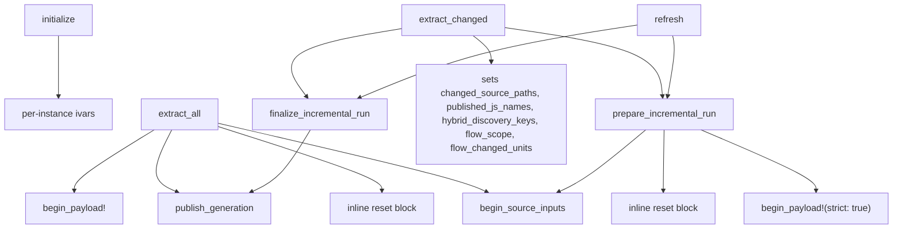

# Extractor run state

`Woods::Extractor` (`lib/woods/extractor.rb`) is reused across runs. The watch daemon and any caller that keeps one instance call `extract_all`, `extract_changed` and `refresh` on it repeatedly. State that one run leaves in an instance variable (ivar) must not change what the next run does.

`spec/extractor_run_state_spec.rb` is the executable copy of this note. It poisons every ivar listed under "Reset at the start of a run", runs the next entry point, and fails if the poison survives.

## Terms

- **Reset**: the ivar is assigned a fresh value (or nil) at the start of a run, before anything reads it.
- **Run**: one call of `extract_all`, `extract_changed` or `refresh`.
- **Scope**:
  - *per-run*: valid for one run, then stale.
  - *per-call*: valid inside one method call.
  - *per-instance*: lives as long as the Extractor, on purpose.
  - *per-process*: no ivar has this scope. The process-wide collaborators are `ModelNameCache` (reset by `ModelNameCache.reset!` at the start of `extract_all` and `prepare_incremental_run`) and the `PathDispatcher` rule memo (configuration-blind, never reset).

## Entry points and shared reset helpers

`begin_source_inputs` and `begin_payload!` are the shared reset helpers. Both paths call them first, so ivars they reset are safe on every entry point.

## Reset at the start of a run

| ivar | set in | reset in | read by | scope |
|---|---|---|---|---|
| `@results` | `extract_all` phases, `register_and_write` (incremental) | `extract_all`; `prepare_incremental_run` | all three entry points | per-run |
| `@extractors` | `extract_all` | `extract_all` | `extract_all` (full path PORO fallback only) | per-run |
| `@package_resolver` | `package_resolver` (lazy) | `extract_all`; `prepare_incremental_run` | all three | per-run |
| `@incremental_extractors` | `extractor_for` (lazy) | `extract_all`; `prepare_incremental_run` | all three (`package_resolver` goes through it) | per-run |
| `@source_collector` | `source_collector` (lazy) | `extract_all`; `prepare_incremental_run` | all three | per-run |
| `@persisted_index_stats` | `persisted_index_stats` (lazy) | `extract_all`; `prepare_incremental_run` | manifest and summary writers | per-run |
| `@graph_sha` | graph write | `extract_all`; `prepare_incremental_run` | manifest writer | per-run |
| `@failed_consumers` | `checked_extraction`, `replace_type_wholesale` | `begin_source_inputs` | `raise_on_handled_extraction_failure!`, identity checks | per-run |
| `@source_reference_refreshed` | source reference passes | `begin_source_inputs` | incremental reference pass, PORO reconciliation | per-run |
| `@source_reference_paths` | `write_source_reference_cache` | `begin_source_inputs` | `verify_source_reference_publication!` | per-run |
| `@source_reference_occurrences` | `enrich_source_references_full` | `begin_source_inputs` | `project_source_references_full` | per-run |
| `@source_reference_baseline` | `prepare_source_reference_baseline` | `begin_source_inputs` | incremental reference pass | per-run |
| `@source_inputs` | `begin_source_inputs` (new `Session`) | `begin_source_inputs` | `write_source_inputs`, `source_consumer_failed?`, module reconciliation | per-run |
| `@publication_error` | `publish_generation` (on failure) | `begin_payload!`; `initialize` | `raise_on_publication_failure!` | per-run |
| `@payload_generation` | `begin_payload!` | `begin_payload!` (nil when it degrades to flat); `initialize` | `write_source_inputs`, `publish_generation` | per-run |
| `@payload_dir` | `begin_payload!` | `begin_payload!`; `initialize` | `payload_dir` and every writer | per-run |
| `@flow_failures` | `extract_all` (before flows), `precompute_flows`, `finalize_incremental_run` | `extract_all`; `finalize_incremental_run` (before any read) | skipped-files writer, flow refresh | per-run |
| `@symlinked_root` | `symlinked_root?` | `extract_all`, `prepare_incremental_run` | `crosses_symlink?`, from `path_spellings` | per-run |
| `@symlinked_dirs` | `symlinked_dir_below?` | `extract_all`, `prepare_incremental_run` | `crosses_symlink?`, from `path_spellings` | per-run |
| `@git_capture` | `git_capture` (lazy `Extraction::GitCapture`) | `reset_git_capture`, first in `extract_all` and `prepare_incremental_run` | git enrichment, commit table, manifest provenance and Git summary, `retain_unit`, `finalize_incremental_unit_json` | per-run |

Reset in `prepare_incremental_run` only. `extract_all` never resets them, and no full-path code reads them, so a value left by an earlier incremental run is stale but inert. Add a reset to `extract_all` before adding any full-path read.

| ivar | set in | reset in | read by | scope |
|---|---|---|---|---|
| `@dependents_dirty` | `mark_dependents_dirty` | `prepare_incremental_run` | `finalize_incremental_unit_json` | per-run |
| `@incremental_written` | `register_and_write` | `prepare_incremental_run` | `finalize_incremental_unit_json` | per-run |
| `@retained_units` | `retain_unit` | `prepare_incremental_run` | source reference pass | per-run |
| `@changed_source_paths` | `extract_changed` (after prepare) | `prepare_incremental_run` (nil, so `refresh` has no change set) | `retain_unit` | per-run |
| `@reference_additions` | lazy, from `@source_reference_baseline` | `prepare_incremental_run` | incremental reference pass | per-run |
| `@library_replacement_touched` | `replace_type_wholesale(:libs)` | `prepare_incremental_run` | `replace_type_wholesale` | per-run |
| `@identity_claims` | `verify_identity_claims!` | `prepare_incremental_run` | identity checks, GraphQL kind withdrawal | per-run |
| `@flow_scope` | `extract_changed` | `prepare_incremental_run` (nil means reassemble every touched controller); `rerun_whole_app_extractors` when routes or controllers re-run | `refresh_incremental_flows` | per-run |
| `@flow_changed_units` | `extract_changed` (the units the changed files define, from the pre-change graph) | `prepare_incremental_run` (nil means no controller is added from the flow inverse) | `refresh_incremental_flows`, through `flow_stepped_controllers` (#945) | per-run |
| `@previous_flow_index_entries` | lazy read of the published flow index | `prepare_incremental_run` | `refresh_incremental_flows` | per-run |
| `@hybrid_discovery_keys` | `extract_changed` | `prepare_incremental_run` (empty set) | changed-path dispatch, `re_extract_unit` | per-run |
| `@active_record_names` | `active_record_names` (lazy) | `prepare_incremental_run` | incremental PORO paths | per-run |
| `@baseline_extraction_config` | `prepare_incremental_run` | `prepare_incremental_run` (always reassigned) | `write_manifest(incremental: true)` | per-run |

## Set during a run, read only after it is set

No reset at the start of the run. Each is assigned before its first read in the same run. This is the shape of the `@results` bug fixed in #848: a new read placed above the assignment would see the previous run's value.

| ivar | set in | read by | scope |
|---|---|---|---|
| `@graph_analysis` | `extract_all` (graph analysis phase), `write_incremental_graph_analysis` | `write_graph_analysis`, `write_structural_summary` | per-run |
| `@eager_load_complete` | `safe_eager_load!` (both outcomes) | reconciliation, identity checks, `register_and_write` | per-run |
| `@published_js_names` | `extract_changed` | `rerun_whole_app_extractors` | per-run |
| `@dependency_graph` | `initialize`; `extract_all` (graph rebuild phase); `prepare_incremental_run` (loaded from the baseline) | everything | per-run |

Notes:

- `@dependency_graph` on the full path: units registered during extraction land in whatever graph the instance held. The graph rebuild phase discards that graph and rebuilds it from the deduped `@results`, so only the rebuilt graph reaches an output.
- A no-op incremental run returns from `finalize_incremental_run` before `write_incremental_graph_analysis`. `@graph_analysis` then still holds the previous run's value, and nothing reads it on that path.

## Per-call

| ivar | set in | reset in | read by | scope |
|---|---|---|---|---|
| `@wholesale_mutations` | `note_wholesale_mutation` | top of every `replace_type_wholesale` | the rescue in `replace_type_wholesale` | per-call |
| `@authoritative_replacement_types` | `with_replacement_ownership` | restored to the previous value in `ensure` | `verify_identity_claims!`, `withdraw_previous_graphql_kinds` | per-call |
| `@released_identity_owners` | `with_changed_path_ownership` | restored to the previous value in `ensure` | `confirmed_discovered_move?` | per-call |

## Per-instance, by design

| ivar | set in | reset in | read by | scope |
|---|---|---|---|---|
| `@output_dir` | `initialize` | never | all | per-instance |
| `@payload_store` | `initialize` | never | `begin_payload!` | per-instance |
| `@pruned_resolvable_classes` | `note_pruned_resolvable` (append) | never | the watch daemon, which dedupes by identifier | per-instance |

## Git state

`Extraction::GitCapture` (`lib/woods/extraction/git_capture.rb`) owns everything a run reads from Git: the availability probe and its reason, the HEAD and branch captured once, whether the history walk failed, the typed units given facts (`note_refreshed`) and the retained units whose facts must be re-read (`request_recheck`). The Extractor holds one capture per run in `@git_capture`, so none of that state can outlive the run. Git becoming available in the middle of a run is not detected; the next run probes again.

## Adding an ivar

1. Decide the scope from the tables above.
2. Per-run ivars: reset in the matching row group (`extract_all`, `prepare_incremental_run`, `begin_source_inputs` or `begin_payload!`).
3. Add it to the matching hash in `spec/extractor_run_state_spec.rb` and to a table here.
